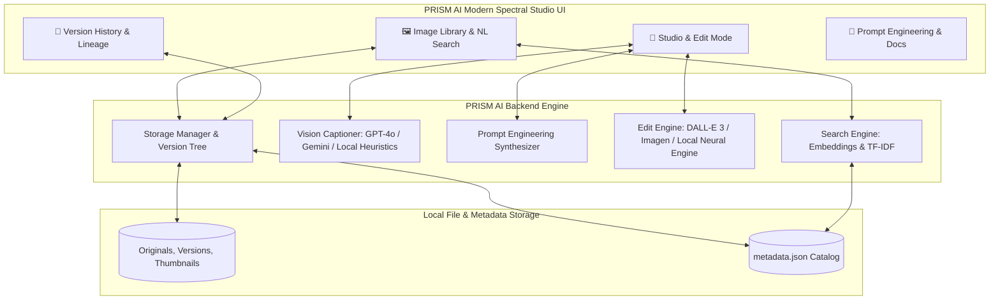
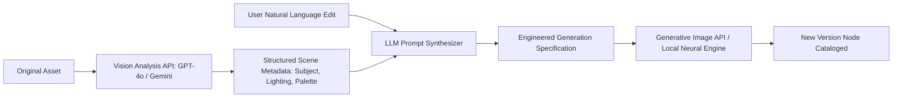

# ◈ PRISM AI — Next-Gen Multimodal AI Visual Studio

[](https://www.python.org/)
[](https://streamlit.io/)
[](https://openai.com/)
[](https://deepmind.google/technologies/gemini/)
[](#-hybrid-offline--cloud-architecture)
[](LICENSE)

> **PRISM AI** is an AI-first multimodal visual creation and editing platform that empowers creators, marketers, designers, and everyday users to search, view, and transform images using pure conversational natural language — eliminating the steep learning curve of traditional legacy editing software.

---

## 🌟 Key Capabilities

### 1. 🔍 Natural Language Semantic Image Search
- Search across your media library using conversational human descriptions:
  - *"Show me the ones with a beach"*
  - *"Photos with a dog in a park"*
  - *"Cozy coffee workspace with warm lighting"*
- **Hybrid Semantic & Vector Search Engine**: Combines vector embeddings (`text-embedding-3-small`), Gemini embeddings, and high-performance local TF-IDF concept expansion so queries match true semantic meaning rather than fragile keyword matching.

### 2. 👁️ Multi-Modal Vision Scene Analysis & Auto-Captioning
- On asset ingestion, vision models (**OpenAI GPT-4o / GPT-4.1-mini** or **Google Gemini 1.5 Flash**) automatically extract:
  - Evocative titles
  - Detailed visual descriptions (subject posture, environment, depth, lighting)
  - 8–14 semantic tags
  - Detected scene entities and objects
  - Dominant color palettes and lighting aesthetics
  - Intelligent enhancement recommendations

### 3. 🎛️ AI Edit Control Center: 1-Click Presets & Custom Instructions
- **7 Curated 1-Click Production Presets**:
  - ✂️ **Studio Cutout**: Isolates subject on a clean studio neutral background with rim lighting.
  - 🌅 **Golden Hour Warmth**: Infuses 2800K radiant sunset rays, amber rim lights, and soft glow.
  - 🌆 **Cyberpunk Neon Glow**: Electrifies the scene with electric cyan, vivid magenta, and high dynamic contrast.
  - 💎 **Ultra Clarity & Detail**: Remasters micro-contrast, crisp textures, and balanced dynamic range.
  - 🎞️ **Vintage 1970s Film**: Analog 35mm film grain, nostalgic Kodachrome colors, and soft vignetting.
  - 🖤 **Dramatic Noir B&W**: Chiaroscuro black & white, deep velvety blacks, and brilliant silver highlights.
  - 🎨 **Ethereal Watercolor**: Fluid pastel watercolor washes with delicate ink contours.
- **Custom Conversational Edit Instructions**:
  - Type plain-English requests like *"remove the background"*, *"add a tree in the background"*, or *"switch to dramatic sunset lighting"*.
  - **Vision-Guided Two-Stage Prompt Synthesizer**: Converts brief user instructions into prompt-engineered specifications preserving subject identity and scene lighting.

### 4. 📜 Non-Destructive Version History & Lineage Rollback
- Complete visual timeline tracking every revision from `v0` (Original) to `v1`, `v2`, etc.
- Each revision node records:
  - High-resolution thumbnail
  - Timestamp
  - Prompt / Preset used
  - Model / Engine tag
- **1-Click Rollback**: Revert to any historical version at any point with zero data loss.
- **Before & After Comparison**: View the original and active version side-by-side in real time.

### 5. ⚡ Hybrid Offline / Cloud Architecture
- **Cloud Ready**: Full support for OpenAI (GPT-4o, Azure OpenAI, DALL-E 3) and Google Gemini (1.5 Flash + Imagen 3).
- **Offline / Zero-Cost Mode**: Built-in smart neural image processor using Pillow & NumPy ensures the application works **100% reliably out of the box** for live presentations, portfolio demos, or evaluation without requiring immediate API keys.

---

## 🏛️ System Architecture



---

## 🧪 Vision-Guided Prompt Pipeline



---

## 🚀 Quick Start Guide

### 1. Prerequisites
- Python 3.10 or higher
- Git

### 2. Clone and Install Dependencies
```bash
git clone https://github.com/prism-ai/prism-ai-studio.git
cd prism-ai-studio

# Install dependencies
pip install -r requirements.txt
```

### 3. (Optional) Configure API Keys
You can set keys via `.env` file or directly inside the PRISM AI Studio sidebar:
```bash
cp .env.example .env
```

Edit `.env`:
```ini
# PRISM AI Platform Configuration
OPENAI_API_KEY=your_openai_api_key_here
GEMINI_API_KEY=your_gemini_api_key_here

# (Optional) Azure OpenAI Configuration
AZURE_OPENAI_API_KEY=your_azure_key_here
AZURE_OPENAI_ENDPOINT=https://your-resource.services.ai.azure.com/api/projects/your-project/openai/v1
AZURE_OPENAI_MODEL=gpt-4.1-mini
```
> *Note: If no API keys are provided, PRISM AI automatically runs in Smart Local Engine mode with pre-seeded portfolio assets so you can immediately test all capabilities!*

### 4. Launch PRISM AI Studio
```bash
streamlit run app.py
```
Open your browser at `http://localhost:8501`.

---

## 📁 Project Structure

```text
prism-ai-studio/
├── app.py                      # Main Streamlit Application (Library, Studio, Versions, Docs)
├── seed_sample_data.py         # Seeds realistic portfolio images and version history
├── requirements.txt            # Python dependencies
├── .env.example                # API key template
├── README.md                   # Complete platform documentation
├── assets/
│   ├── style.css               # Spectral obsidian custom stylesheet
│   └── samples/                # Seed sample images
├── backend/
│   ├── __init__.py
│   ├── config.py               # Paths, model configurations, and preset specs
│   ├── storage.py              # Version tracking, thumbnails, metadata persistence
│   ├── prompt_templates.py     # Prompt engineering templates for vision & generation
│   ├── vision_captioner.py     # Vision analysis (GPT-4o, Gemini, local heuristics)
│   ├── edit_engine.py          # AI image editing dispatcher & prompt synthesizer
│   ├── local_editor.py         # High-fidelity local image processing engine
│   └── search_engine.py        # Natural language semantic search (TF-IDF + embeddings)
├── data/
│   ├── images/                 # Image storage (originals, versions, thumbnails)
│   └── metadata.json           # Metadata catalog with version trees
├── docs/
│   └── API_AND_PROMPTS.md      # In-depth API selection & prompt engineering guide
└── notebooks/
    └── prompt_engineering.ipynb # Jupyter notebook demonstrating prompt handling
```

---

## 🎯 Deliverables & Capabilities Matrix

| Objective / Deliverable | Status | Implementation Details |
| :--- | :---: | :--- |
| **Natural Language Editing Interface** | ✅ Completed | Streamlit Studio tab with 1-click presets & conversational prompt input |
| **LLM + Vision Input Integration** | ✅ Completed | `backend/vision_captioner.py` and `backend/prompt_templates.py` |
| **Non-Destructive Version History** | ✅ Completed | `backend/storage.py` tracking parent-child revisions with thumbnails & timestamps |
| **Thumbnails & 1-Click Rollback** | ✅ Completed | Auto-generated thumbnails + instant version reversion |
| **Prompt Engineering Pipeline** | ✅ Completed | `backend/prompt_templates.py` & `notebooks/prompt_engineering.ipynb` |
| **API Architecture & Selection Guide** | ✅ Completed | `docs/API_AND_PROMPTS.md` |
| **Natural Language Semantic Search** | ✅ Completed | `backend/search_engine.py` matching queries like *"show me the ones with a beach"* |
| **Zero-Cost Local Acceleration** | ✅ Completed | `backend/local_editor.py` providing instant offline image filters |

---

## 🚢 Deployment Guide

### Deploying to Streamlit Community Cloud
1. Push this repository to GitHub.
2. Sign in to [Streamlit Community Cloud](https://share.streamlit.io/).
3. Select your repository, branch `main`, and main file `app.py`.
4. In Advanced Settings, add your `OPENAI_API_KEY` and/or `GEMINI_API_KEY` under Secrets.
5. Click **Deploy**.

### Deploying to Hugging Face Spaces
1. Create a new Space with the **Streamlit** SDK.
2. Push repository code to the Hugging Face Space repository.
3. Configure repository Secrets for API keys.

---

## 👥 Authors & Collaborative Team

**PRISM AI** is developed and maintained as a joint collaborative project by the founding development team.

---

## 📄 License
This project is licensed under the MIT License — see the [LICENSE](LICENSE) file for details.
